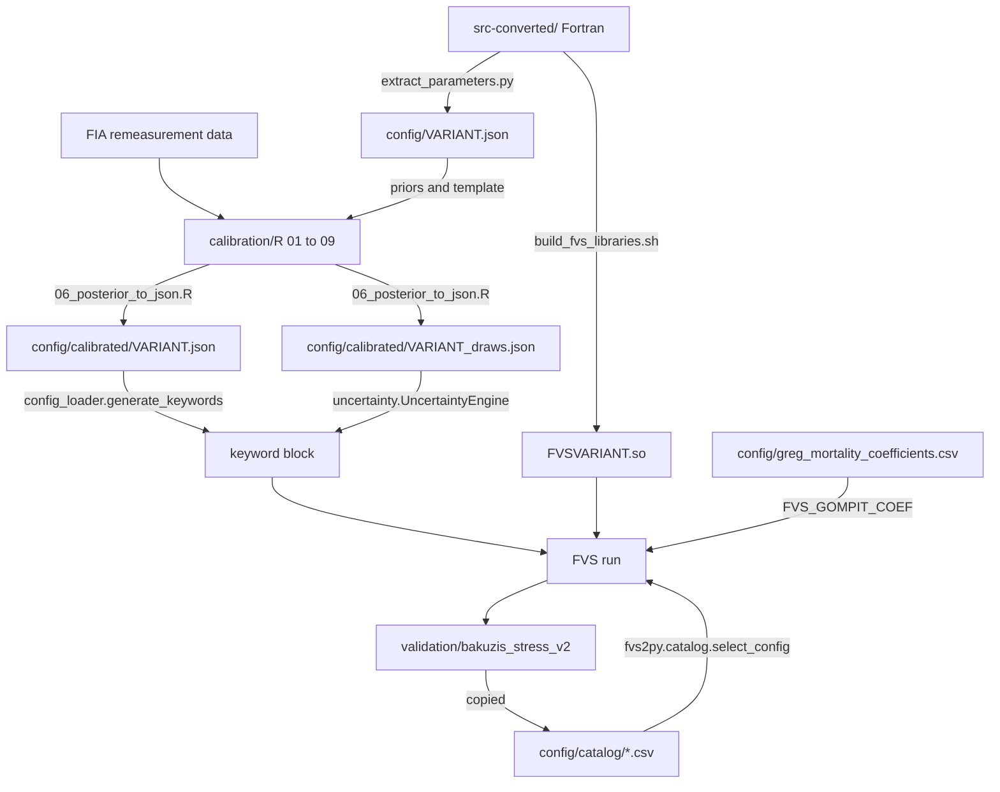

# Architecture

fvs-modern spans three ecosystems. The simulation engine is Fortran, the Bayesian calibration pipeline is R (CmdStan through cmdstanr and brms), and configuration handling, runtime wrappers and post-processing are Python. This page maps the repository and shows how the parts hand data to one another. Each later page in this section documents one part in detail.

## Repository layout

| Path | Role |
|---|---|
| `src-converted/` | The converted FVS source tree in free-form Fortran. This is the build input. |
| `src-converted/base/`, `src-converted/vbase/` | Core simulation engine and shared variant base routines. |
| `src-converted/<variant>/` | Regional variant code (for example `ne/`, `ie/`, `acd/`); the Canadian variants live under `src-converted/canada/bc/` and `src-converted/canada/on/`. |
| `src-converted/bin/FVS<variant>_sourceList.txt` | Per-variant source lists that the build script reads. |
| `src-converted/stubs/` | Stub sources compiled into `libfvs_stubs*.so`. |
| `src-converted/tests/` | Per-variant keyword-file regression cases (`FVSne/`, `FVSie/`, and so on) and `test.py`. |
| `deployment/scripts/` | Build, test, install and upstream-sync shell scripts. |
| `deployment/fvs2py/`, `deployment/microfvs/` | Python ctypes wrapper and FastAPI service. |
| `config/` | Default parameter JSON per variant, calibrated configs under `config/calibrated/`, the loader, the uncertainty engine, coefficient CSVs and the configuration catalog. |
| `calibration/` | R fitting scripts (`R/`), Python projection and aggregation scripts (`python/`), SLURM templates (`slurm/`, `osc/`), stress-test tooling (`stress/`). |
| `modernization/` | Fortran conversion tools, the parameter extractor and the Fortran DATA generator. |
| `variant-tools/` | Templates and helper scripts for creating a new variant. |
| `tools/` | Diagnostic guards for keyword files, listings and input data (`fvs_run_guards.py`, `fvs_input_guards.py`). |
| `evaluation/` | Dated evaluation evidence, for example `evaluation/postfreeze_20260805/` (`inputguard/`, `kwfix/`, `maxcyc/`). |
| `scripts/` | Repository maintenance scripts such as `audit_nvel_upstream.py`. |
| `.github/workflows/` | CI, cross-platform, Docker publish and upstream-sync workflows. |

The repository root also carries topic documents: `CALIBRATION.md`, `KNOWN_ISSUES.md`, `STOP_CODES.md` and `CHANGELOG.md`. The CONUS design set (`CONUS_BLOCK_SCHEMA.md`, `CONUS_MODEL_SPECIFICATION.md` and related files) and the dated session notes that used to sit beside them were moved to `docs/archive/` on October 30, 2026 (see the [Archive](../archive/index.md)). Where a root or archived document and the code disagree, the code governs, and these reference pages follow the code.

!!! note "Validation tree"
    The validation pipeline lives in `validation/bakuzis_stress_v2/`. Its outputs that the runtime reads are copied into `config/catalog/`. See [Validation](validation.md).

## The engine

The engine is the FVS growth loop compiled once per variant. `deployment/scripts/build_fvs_libraries.sh` reads `src-converted/bin/FVS<variant>_sourceList.txt`, compiles every listed file with gfortran, and links a shared library `FVS<variant>.so`. A variant library combines `base/` and `vbase/` routines with the variant's own growth, mortality, crown and site routines, sized by the variant's `PRGPRM.f90` (`MAXSP` is 23 in `base/PRGPRM.f90` and 108 in `ne/common/PRGPRM.f90`). A companion script, `deployment/scripts/build_fvs_executables.sh`, links standalone executables that include `main.o`. See [Building the engine](building-the-engine.md).

Several model options are compiled into every library and switched at run time by environment variables read through `GETENV`, so one binary serves several model arms. The GOMPIT survival model (`FVS_GOMPIT`, `FVS_GOMPIT_COEF`) is the one the configuration catalog uses; others include the NE background-mortality hooks in `vls/morts.f90` (`FVS_MORT_HALVE`, `FVS_MORT_CRB`, `FVS_MORT_CRREF`) and the Greg Johnson growth hooks in `base/gregdghg.f90`, `base/greghghg.f90` and `base/greghtdbh.f90`. See [Mortality models](mortality-models.md).

## Configurations

Each variant has a default parameter file `config/<variant>.json` produced by `modernization/extract_parameters.py` from the Fortran DATA statements. The calibration pipeline writes `config/calibrated/<variant>.json` (posterior point estimates plus a `calibration_multipliers` block) and `config/calibrated/<variant>_draws.json` (subsampled posterior draws). `config/config_loader.py` selects among parameter sets at run time and turns a calibrated config into FVS keywords (SDIMAX, BAMAX, MORTMULT, BAIMULT, HTGMULT). The engine never reads the JSON directly: calibration reaches FVS through keywords or through fvs2py species attributes. See [Configuration files](configuration-files.md).

## Calibration

`calibration/R/` holds numbered scripts that fit the component models to FIA remeasurement data per variant (`01` to `09`, with `06_posterior_to_json.R` assembling the outputs), and a second, CONUS-wide series (`30` onward) whose results land in the `categories_conus` and `categories_conus_sf` blocks. See [Calibration pipeline](calibration-pipeline.md).

## Deployment wrappers

`deployment/fvs2py/` loads a variant library through ctypes and exposes the FVS API entry points (`fvssetcmdline_`, `fvssummary_`, `fvsdimsizes_`, `fvstreeattr_`). Its `fvs2py.catalog` module reads `config/catalog/` and returns a recommended arm, a `config_version` and any environment variables the arm needs. `deployment/microfvs/` wraps FVS as a FastAPI service. `deployment/docker/`, `deployment/aws/` and the platform scripts in `deployment/scripts/` (`deploy_laptop.sh`, `setup_macos.sh`, `setup_wsl.sh`) install FVS-Online and the libraries.

## Validation

The Bakuzis stress pipeline in `validation/bakuzis_stress_v2/` runs the engine on FIA stands for 100 years under several arms, scores each trajectory against law-like stand relations, applies pre-registered gates and writes the two catalog tables. The runtime consumes only those tables. See [Validation](validation.md).

## How the parts connect

In the diagram `VARIANT` stands for a variant code such as `ne`. The arrows follow the code paths documented on the later pages. Two points are easy to miss. First, the calibrated JSON is a template copy of the default JSON with fitted values written over it, so both files share the `categories` schema. Second, the catalog does not change any parameter; it records which combination of parameter set and survival model passed the long-horizon gates for each variant.
