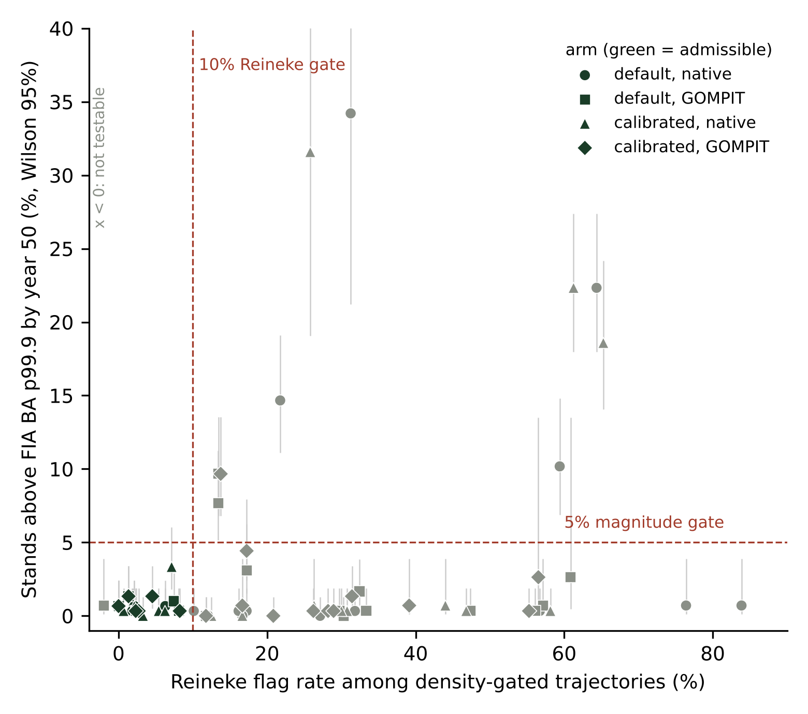
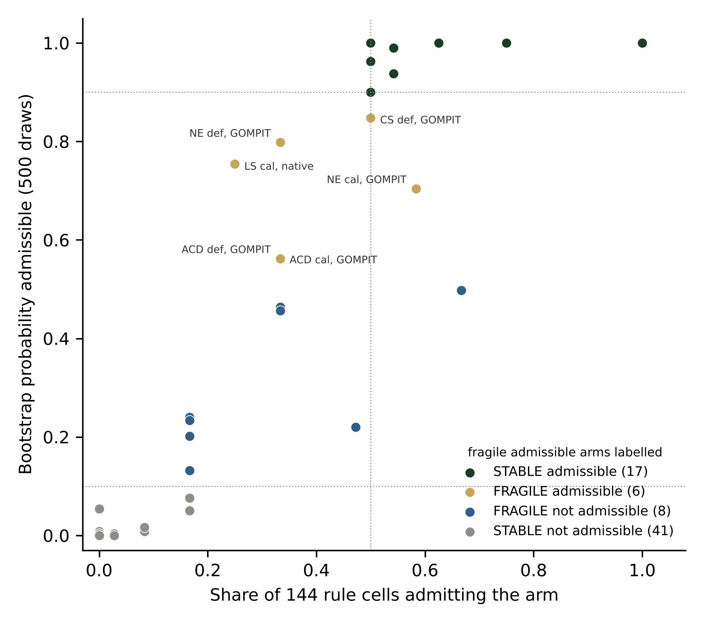

# A configuration catalog for fvs-modern across the FVS variants of the conterminous United States: Bakuzis admissibility gates, stress test, and selector

Aaron R. Weiskittel, Center for Research on Sustainable Forests, University of Maine. CRSF Technical Report, October 29, 2026; revised October 30, 2026 (version 1.2.0).

## Summary

fvs-modern can run every Forest Vegetation Simulator (FVS) variant with either the variant's native mortality or GOMPIT crown closure survival, and with either the fvs-modern default parameters or a Bayesian calibrated maximum a posteriori (MAP) set. A user needs to know which of those four combinations stays biologically plausible over the horizons FVS is used for. This report describes a configuration catalog that answers that question per variant from evidence, the pre-registered rule behind it, the red team repairs that changed it, the stress test run after it shipped, and the selector that reads it. For each of 18 variants, up to 300 FIA plots (4,748 stands in all) were projected 100 years under all four arms and gated on the FIA fitting envelope (the plot level basal area p99.9 and the stand density index p99.9), on Reineke self-thinning, and on a stocking lower bound. Seven variants have at least one admissible fvs-modern arm (ACD, BM, CS, LS, NE, SN, WS) and eleven do not (CA, CI, CR, EC, EM, IE, PN, SO, TT, UT, WC), nearly all on the self-thinning axis alone. A stress test of 144 alternative rules and 500 stand bootstraps changed none of the 72 arm verdicts; six admissible and eight not-admissible arms are fragile, and the catalog carries that label. The catalog was regenerated on the evening of October 29 after the cause of the year zero seeding failures was found in the stand generator (FIA live records with a null TPA_UNADJ had been filled with 6.0 trees per acre); every sampled stand now passes the year zero gate and no verdict changed. On October 30 the calibrated arms were rerun after a second defect was found: the in-process calibrated overlay wrote a maximum stand density index of 0 for species without a calibrated value (fvs-modern pull request 135). Four verdict fields changed (the least bad arm named for EM and for WC, one alternative rule verdict in WC, and one stability label in NE), and no status and no primary rule verdict changed. The catalog was then rerun once more on all four arms (catalog v8, fvs-modern pull requests 144 and 145) after the expansion of condition trees was corrected to use the condition's share of each plot size (MICRPROP_UNADJ, SUBPPROP_UNADJ, MACRPROP_UNADJ) rather than CONDPROP_UNADJ alone (D5); 266 of the 4,748 stands seeded more than 2 percent differently, no primary rule verdict, recommended arm or status changed, WC lost its two alternative rule admissible arms (Wilson upper bound of the Reineke flag rate 0.249 and 0.247 to 0.251) and so is no longer rule sensitive, and WS calibrated native moved from fragile to stable admissible; this report describes that catalog (version 1.2.0 of the Zenodo record). The catalog, the gate table, the scripts, and the per variant Bakuzis scorecards are in the fvs-modern repository (catalog v8 in pull requests 144 and 145, which build on main at fb4cf10d) and in the Zenodo record that accompanies this report.

## Why a catalog

The Bakuzis matrix (Leary 1997) tests whether a growth model's long projections obey the law-like relations among stand properties: height and age ordering by site, Reineke's stems against mean diameter, the Sukachev effect, Eichhorn's rule, and yield against density. The earlier fvs-modern work applied that matrix to a synthetic 36 cell design for the Northeast and Acadian variants and to the Northeast Paper 2 cohort, and the fvs-conus projector was scored the same way. Those tests settled the two northeastern variants and said nothing about the other twenty. At the same time, the fvs-modern survival switch and the calibrated parameter set had never been tested together outside the Northeast, and a code defect found on October 28 (a six argument GOMPSURV interface updated in one variant's mortality routine and not in the other 21) meant that every GOMPIT result produced on a variant other than NE, CS and LS between July 25 and October 28 came from an undefined read. With that fixed and all 22 variant libraries rebuilt, the question became whether a user could pick a survival model and a parameter set for their variant on evidence rather than by habit. The catalog is that evidence.

## Stand sample and projection arms

The sample frame is the plot level roll up of the CONUS remeasurement pairs file used to fit the fvs-conus projector, which assigns each plot to an FVS variant. Up to 300 plots per variant were drawn with a fixed seed (17 variants carry plots; PN has 38, CA and TT 142, WC 226, the rest 300). The Acadian variant has no assignment in that file and uses the Northeast plots in Maine, New Hampshire and Vermont, which is an assumption the catalog states. Five variants with no plots in the frame (AK, KT, NC, OC and OP) are reported as not evaluated rather than filled from another source. Each plot's first measurement condition was written to FVS stand and tree initialization tables with the public FIA coordinate, the condition's site species and the variant's Forest Service region. Trees are those of the sampled condition, expanded by the condition's share of the plot size each tree was measured on (MICRPROP_UNADJ for microplot trees, SUBPPROP_UNADJ for subplot trees and MACRPROP_UNADJ for macroplot trees), which is how FIA computes the live basal area the gates compare against, and species the compiled variant does not carry are relabelled to its other softwood or other hardwood code as FVS itself does on input. A year zero gate records whether each stand entered the engine within 20 percent of its FIA live basal area (or within 1 ft² ac⁻¹ for the few stands too sparse for a relative tolerance); only stands that pass enter the gates. In the first catalog that gate failed 263 stands, nearly all eastern, which entered above their FIA basal area at a median of 1.46 times. The cause was found on October 29: FIA live tree records with a null TPA_UNADJ (periodic to annual growth, removal and mortality trees on legacy subplot numbers, 2002 to 2008 plots), which carry no area expansion and contribute nothing to BALIVE, were filled with 6.0 trees per acre by the stand generator and entered the engine as real trees. Single cycle runs showed the engine reproducing its input exactly, so the excess was in the input. The generator now drops those records (3,617 records from 371 stands: SN 205 stands, CS 79, LS 66, NE 21), the catalog was regenerated, and all 4,748 sampled stands pass the gate.

Every stand was projected 100 years at a 5 year step under four arms: default and calibrated MAP parameters, each with native and GOMPIT survival, with no regeneration keywords and no posterior draws. EM and IE run with NOAUTOES because their establishment models otherwise add stems in every projection; no other variant establishes regeneration. The runs were Cardinal array jobs 15976824 and 15984133 after library build 15967530 with the GOMPSURV fix. The calibrated arms of the current catalog were rerun with the overlay fix in array 16016015 on October 30 on the same sample and seed; the default arms are not touched by the overlay and were carried over, and a rerun of 10 stands each in CA and WC with the fixed code reproduced them with zero difference. All four arms were then rerun with the plot-size expansion in array 16023222 (catalog v8), which is the catalog reported here. The fvs-conus projector arms (b1 and b2 by native and GOMPIT) are listed in the gate table for comparison from an October 27 rescore of 1,500 stands per variant, with the caveat that they were neither run on the common sample nor through this engine.

## The pre-registered rule

The rule was fixed before any catalog run was scored and red teamed blind before the runs started; the seven confirmed design defects (one common stand sample for every engine arm, a 50 year primary horizon with Wilson bounds, an under stocking lower bound, one shared variant assignment, and confirmation that the projector's GOMPIT is R side and unaffected by the Fortran defect) were folded in. An arm is admissible for a variant when all of the following hold on seed passing stands: fewer than 5 percent of stands exceed the FIA basal area p99.9 by year 50 and the Wilson 95 percent upper bound of that share is under 10 percent; the same for the SDI p99.9; the Reineke flag rate among trajectories evaluated above a relative density of 0.55 is under 10 percent on at least 10 evaluated trajectories, with fewer evaluated counted as not tested and inadmissible; the median year 50 basal area is at or above the FIA p50; and a calibrated arm's trajectories differ from the default arm's. Among admissible arms the simplest wins (default before calibrated, native before GOMPIT), except where per variant near term evidence separates the survival models, which at present is only the Northeast cohort of Paper 2, so NE prefers GOMPIT among its admissible arms. A variant with no admissible arm is not recommended for long horizon use and the least bad arm by 50 year basal area exceedance is named for information.

The thresholds are plot level percentiles of the fitting data by variant. They are age censored population extremes, so a variant whose inventory is young or managed has a lower ceiling than its unmanaged stands could reach; the 50 year gate limits how far that bias reaches, and where a variant has fewer than 1,000 fitting plots the p99.9 is the sample maximum, which the gate table discloses. An alternative Reineke gate, the Wilson upper bound of the flag rate under 25 percent on at least 30 evaluated trajectories, was added after the interim scoring showed the western pattern and before the final scoring; both verdicts are carried and the catalog flags the seven variants where they differ. The catalog ships under the primary rule, a decision of October 29, 2026, because the alternative admits western arms by declining to test their self-thinning.

A first catalog was pushed on the morning of October 29 and red teamed blind. Four defects that each made the gates easier than the documentation claimed were confirmed and the catalog was regenerated rather than patched: the under stocking bound used the 100 year peak, which includes year zero and could not fail; a Reineke gate with fewer than 10 evaluated trajectories counted as a pass; stands that failed the year zero gate were scored; and the calibrated arms for ACD and IE were identical to default because the keyword loader raised on those variants' per species BAMAX array and aborted the calibrated block. The loader now skips that array with a warning, both variants were rerun, and a distinctness check guards every variant. The same review found the cause of the two seeding failure modes carried from earlier work: partial conditions expanded per plot acre rather than per condition acre (the exact 0.75 under seeding), and an all plot fallback in the runner when a condition's trees were not found (the southern over seeding). Both are gone.

## Results

Table 1 gives the verdict by variant and Figure 1 places all 72 engine arms in the space of the two gates that decide. Under the primary rule seven variants have admissible fvs-modern arms: ACD, BM, CS, NE and SN on all four, LS on the two calibrated arms, and WS on calibrated native alone. Eleven do not. In CA, CI, CR, EC, IE, SO, TT and UT every arm passes the magnitude and stocking gates and fails only on the Reineke axis; in EM every arm fails both the basal area gate and the Reineke gate, and in WC the arms that pass magnitude fail on Reineke; PN fails the basal area gate on 38 stands. The magnitude test is passed almost everywhere: the 50 year share above the basal area p99.9 is at or below 1.7 percent in 14 of 18 variants, the SDI ceiling is never exceeded by more than 5.3 percent of stands (WC calibrated native), and the year 50 lower bound passes in every arm. The exceptions are EM (22 percent on both native arms, with 8 and 10 percent on the default and calibrated GOMPIT arms), LS (15 and 10 percent on the default arms), WC (10 and 19 percent on the default and calibrated native arms) and PN (34 and 32 percent native).

Two patterns sit behind the Reineke failures. In CA, TT, UT, WC, EM and CR the default native arm does not self-thin: median within stand slopes of log stems on log quadratic mean diameter are -0.83, -0.84, -1.12, -1.11, -1.04 and -1.46 against Reineke's -1.605, with flag rates of 27 to 84 percent, and calibrated GOMPIT moves the medians to -1.56 to -1.90 while the flag rates stay at 14 to 39 percent because the slopes are dispersed across stands. In EM and IE the regeneration confound is gone with NOAUTOES, stems now decline, and the flag rates remain at 13 to 64 percent in EM and 32 to 56 percent in IE, so the self-thinning failure stands on its own. Across the West only 18 to 202 trajectories per variant reach the relative density gate on the best populated arm, and in SO and TT the flag rate rests on 17 to 18 and 7 to 31 trajectories. The projector arms are a different population: their median 50 year basal area exceedance across variants is 19 percent for b1 native, 6 percent for b2 native and 2 to 3 percent under GOMPIT, and none is admissible under the primary rule.

**Table 1.** Catalog verdict by FVS variant under the primary rule (`config/catalog/catalog_recommendation_by_variant.csv`). Stands are seed passing stands on the engine arms. The bootstrap probability is the share of 500 stand resamples in which the variant keeps at least one admissible engine arm; the grid share is the share of 144 alternative rule cells that admit one (`stress_by_variant.csv`).

| Variant | Stands | Recommended arm | Status | Admissible engine arms | Bootstrap probability | Grid share | Rule sensitive |
|---|---|---|---|---|---|---|---|
| ACD | 300 | default, native | Recommended | all four | 1.00 | 0.50 | no |
| BM | 300 | default, native | Recommended | all four | 1.00 | 0.75 | yes |
| CA | 142 | calibrated, GOMPITᵃ | Not recommended | none | 0.00 | 0.00 | yes |
| CI | 300 | calibrated, nativeᵃ | Not recommended | none | 0.50 | 0.67 | yes |
| CR | 300 | calibrated, GOMPITᵃ | Not recommended | none | 0.35 | 0.52 | yes |
| CS | 300 | default, native | Recommended | all four | 1.00 | 0.62 | no |
| EC | 300 | calibrated, GOMPITᵃ | Not recommended | none | 0.15 | 0.17 | yes |
| EM | 300 | projector b2, GOMPITᵃ | Not recommended | none | 0.00 | 0.03 | no |
| IE | 300 | calibrated, GOMPITᵃ | Not recommended | none | 0.00 | 0.00 | no |
| LS | 300 | calibrated, native | Recommended | calibrated native, calibrated GOMPIT | 0.99 | 0.54 | no |
| NE | 300 | default, GOMPIT | Recommended | all four | 1.00 | 0.58 | no |
| PN | 38 | calibrated, GOMPITᵃ | Not recommended | none | 0.00 | 0.00 | no |
| SN | 300 | default, native | Recommended | all four | 1.00 | 1.00 | no |
| SO | 300 | calibrated, GOMPITᵃ | Not recommended | none | 0.42 | 0.33 | yes |
| TT | 142 | projector b2, GOMPITᵃ | Not recommended | none | 0.25 | 0.17 | yes |
| UT | 300 | calibrated, GOMPITᵃ | Not recommended | none | 0.01 | 0.00 | no |
| WC | 226 | default, GOMPITᵃ | Not recommended | none | 0.01 | 0.08 | no |
| WS | 300 | calibrated, native | Recommended | calibrated native | 0.92 | 0.50 | yes |

ᵃ Least bad arm by 50 year basal area exceedance, named for information; no arm is admissible. AK and NC have no fitting plots and are NOT EVALUATED.

**Figure 1.** The 72 engine arms in the space of the two gates that decide the catalog: the Reineke flag rate among trajectories above the relative density gate against the share of stands above the FIA basal area p99.9 by year 50, with Wilson 95 percent intervals. Green symbols are admissible under the primary rule. Arms at a negative flag rate have fewer than 10 evaluated trajectories and are not testable.

## Stress test of the shipped catalog

After the catalog shipped, the verdicts were stress tested against the analyst choices in the rule that could have gone another way, from the trajectory level data and without new engine runs (`stress_catalog.R`, Cardinal job 16033492 on the current catalog, v8; 16016080 on v6, 16003647 on version 1.1.0 and 15990793 on the first). The first part is a rule grid of 144 cells: horizon 50 or 100 years, exceedance tolerance 3, 5 or 10 percent, Wilson upper bound 10 or 15 percent, basal area ceiling at the p99.9 or the p99, Reineke flag tolerance 10, 15 or 25 percent, and a minimum of 10 or 30 evaluated trajectories. The second is a stand bootstrap, 500 resamples with replacement per variant under the shipped rule. Recomputing the shipped rule inside the stress script reproduced all 72 catalog verdicts, which is also an independent check of the gate script.

The bootstrap splits the 23 admissible arms into 17 stable (admissible in at least 90 percent of resamples and at least half the grid) and 6 fragile, and the 49 not admissible arms into 41 stable and 8 fragile (Table 2, Figure 2). At the variant level, which is what the selector acts on, the seven recommended variants keep at least one admissible engine arm in 100 percent of resamples for ACD, BM, CS, NE and SN, 99 percent for LS and 92 percent for WS. The fragile not admissible arms are all among the thirteen that a 25 percent Reineke tolerance admits, and the bootstrap puts all eight below even odds (CI default native sits at 0.50), so the primary rule's refusal to recommend them is not an artifact of one draw of stands. CA, IE, PN and UT are admitted by no cell of the grid. The grid shows where the rule does its work: the Reineke tolerance is the only axis that changes recommended variants (25 percent admits 12 further arms in CI, CR, EC, SO, TT, WC and WS); the p99 ceiling admits only three arms anywhere, so the shipped p99.9 is the permissive end of the magnitude axis; the 100 year horizon removes one arm (LS calibrated native) and no variant; the 3 percent tolerance removes four arms and no variant; the minimum of 30 evaluated trajectories changes nothing. In NE the stable arm is default native (96 percent) while the shipped preference for GOMPIT rests on the Paper 2 near term cohort, so the catalog's NE choice trades long horizon stability for near term evidence and the selector's note says so.

**Table 2.** The fourteen arms whose verdict is fragile under the stand bootstrap or the rule grid (`stress_by_arm.csv`). Bootstrap probability is the share of 500 stand resamples in which the arm is admissible under the shipped rule; grid share is the share of 144 rule cells that admit it.

| Variant | Arm | Shipped verdict | Bootstrap probability | Grid share | Stability |
|---|---|---|---|---|---|
| ACD | calibrated, GOMPIT | admissible | 0.56 | 0.33 | fragile |
| ACD | default, GOMPIT | admissible | 0.56 | 0.33 | fragile |
| CS | default, GOMPIT | admissible | 0.85 | 0.50 | fragile |
| LS | calibrated, native | admissible | 0.75 | 0.25 | fragile |
| NE | calibrated, GOMPIT | admissible | 0.70 | 0.58 | fragile |
| NE | default, GOMPIT | admissible | 0.80 | 0.33 | fragile |
| CI | default, native | not admissible | 0.50 | 0.67 | fragile |
| CR | calibrated, native | not admissible | 0.22 | 0.47 | fragile |
| EC | default, native | not admissible | 0.13 | 0.17 | fragile |
| SO | calibrated, GOMPIT | not admissible | 0.46 | 0.33 | fragile |
| SO | calibrated, native | not admissible | 0.20 | 0.17 | fragile |
| SO | default, GOMPIT | not admissible | 0.46 | 0.33 | fragile |
| SO | default, native | not admissible | 0.24 | 0.17 | fragile |
| TT | calibrated, GOMPIT | not admissible | 0.23 | 0.17 | fragile |

**Figure 2.** Stability of every shipped verdict: the share of 144 rule cells admitting each arm against the bootstrap probability that it is admissible under the shipped rule. No verdict is overturned; the six fragile admissible arms are labelled.

## The selector

The catalog lives in `config/catalog/` as two tables and is read by `fvs2py.catalog.select_config(variant, survival=None, parameter_set=None)`. The call returns the arm, the configuration version to pass to the engine, the environment variables that switch GOMPIT on, the admissible set, and a note when the caller forces an arm the catalog did not admit, when the Reineke axis was not testable, when a calibrated arm is not distinct from default, or when the verdict is rule sensitive. When a variant has no admissible arm the selector returns the least bad engine arm with the not recommended status attached, falling back from a projector arm where that is the least bad overall. AK and NC return not evaluated. The stress labels sit beside the catalog in `validation/bakuzis_stress_v2/catalog/stress/` and a user choosing a fragile admissible arm should read them.

## Limitations and open items

Per variant near term accuracy is the gap. The only near term scorecard is the Northeast cohort of Paper 2, so outside NE the tie break among admissible arms is simplicity alone and the catalog says so in its `nearterm_evidence` column. The calibrated MAP is a point estimate here; the Paper 1 ensemble shows the posterior band for NE and ACD only. None of the arms establishes regeneration, so a 100 year plateau or decline in stems is partly a design choice. The common sample is unstratified, so the site ordering, Eichhorn, Sukachev and yield density relations are confounded by stand selection and are reported in the per variant scorecards but not gated; the synthetic 36 cell matrix remains the clean test of those relations. The year zero seeding failures of the first catalog are explained and removed (null TPA_UNADJ records); the Paper 1 ensemble was rerun on October 30 with condition level stand seeding and corrected posterior draw keywords (memo Section 18), which moved some of its scorecard counts. The thresholds are the sample maximum in small variants. The projector b1 GOMPIT arm has no NE or SN rows in the October 27 rescore. These are stated in `implementation-notes.md` with the thirteen numbered deviations from the pre-registered plan.

## Data and code availability

The catalog tables, gate table, stress tables, per variant scorecards, scripts, run index and the running memo (Sections 1 to 19) are on the fvs-modern main branch of the advanced-forestry-systems organization (pull requests 118 to 137, 144 and 145; the current catalog is `gates_v8`), under `config/catalog/` and `validation/bakuzis_stress_v2/`. The Zenodo record that accompanies this report (concept DOI 10.5281/zenodo.23777723; version 1.0.0 at 10.5281/zenodo.23777724 holds the first catalog, version 1.1.0 at 10.5281/zenodo.23788727 the catalog regenerated after the seeding fix, and version 1.2.0 the catalog rerun after the overlay fix and the plot-size expansion fix) carries the same tables and scripts with their checksums, this report, and the presentation. FIA plot identifiers and coordinates do not appear in any deposited file; the stand sample is described by variant and count only.

## References

Crookston, N.L., and G.E. Dixon. 2005. The forest vegetation simulator: a review of its structure, content, and applications. Computers and Electronics in Agriculture 49: 60 to 80.

Leary, R.A. 1997. Testing models of unthinned red pine plantation dynamics using a modified Bakuzis matrix of stand properties. Ecological Modelling 98: 35 to 46.

Reineke, L.H. 1933. Perfecting a stand-density index for even-aged forests. Journal of Agricultural Research 46: 627 to 638.
