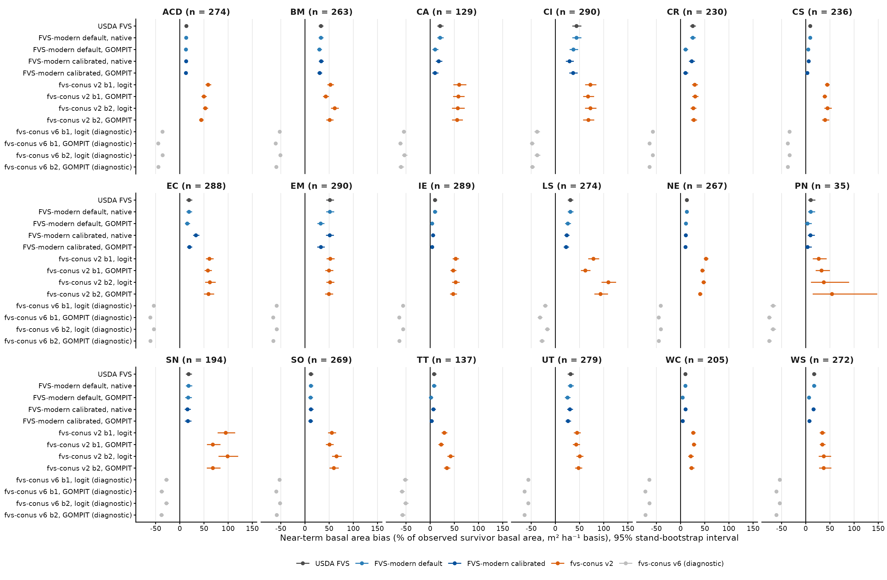
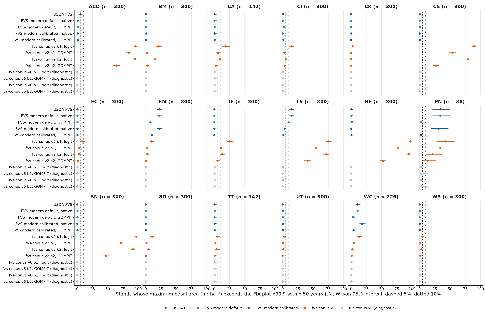
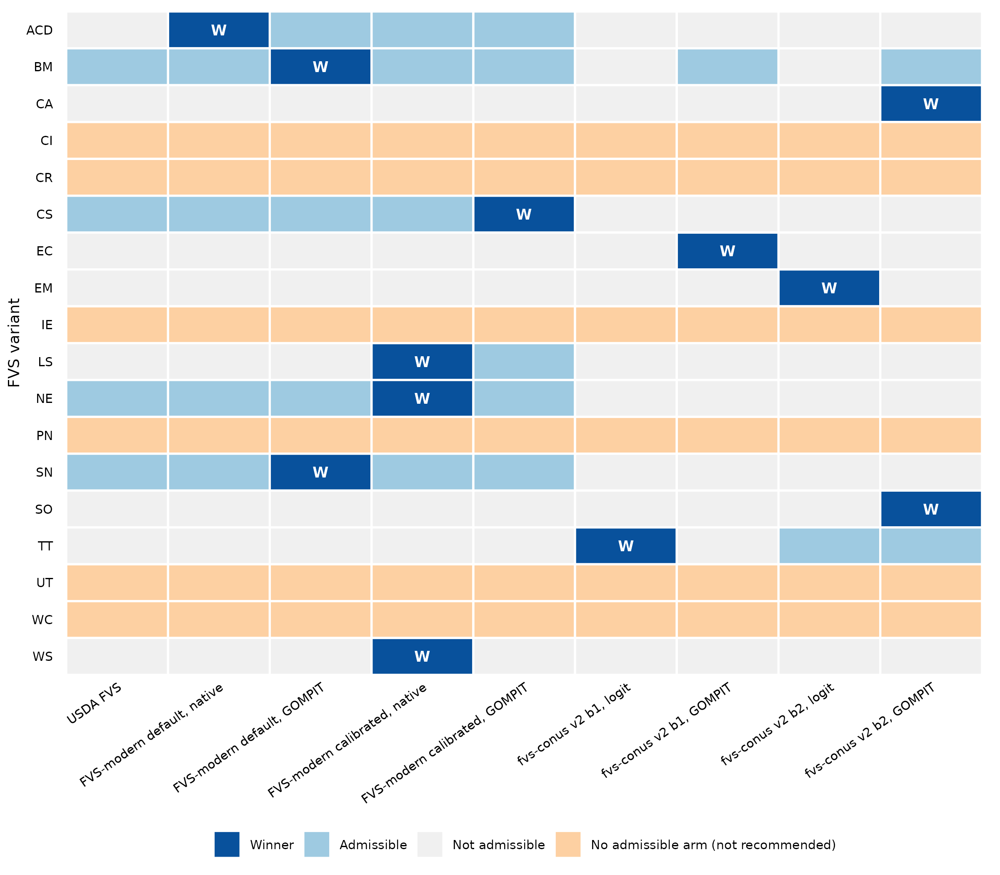

# Summary

We compared three model families on the same 4,748 FIA stands across the 18 FVS variants that have FIA fitting data:

- FVS-modern, with four arms (default and calibrated parameters, each with native or GOMPIT mortality).
- The fvs-conus continental projector, with v2 and v6 each run in four arms.
- Unmodified USDA FVS.

Each stand was projected 100 years and over one remeasurement interval, under a decision rule fixed before any full-run result.

Six findings stand out.

- **FVS-modern default with native mortality reproduces unmodified USDA FVS exactly in 15 of 18 variants** on every stand over 100 years.
- **Every engine arm over-predicts near-term survivor basal area.** Bias ranges from +1.7% to +51.5% depending on variant and arm.
- **GOMPIT mortality lowers near-term bias in every variant for the default parameters** and in 16 of 18 for the calibrated parameters.
- **fvs-conus v2 overgrows.**
  - Its near-term basal area bias is +21% to +110%.
  - Its long-term gates fail in every eastern variant.
  - It passes only in six western variants.
- **fvs-conus v6 collapses basal area** (−21% to −68% near term), consistent with a miscalibrated stand basal area cap.
- **Six variants (CI, CR, IE, PN, UT, WC) have no arm that passes the long-term gates.** In four others (CA, EC, EM, SO) the winner is the only admissible arm and has large near-term bias. Those should be read as least bad, not good.

# Why a run-off

Earlier projector scores (Paper 2, Table 6) used 1,500 stands per variant, while the engine catalog used a different 300 per variant, so family differences were confounded with stands. Here every contestant projects the same stands, built by one function and scored by the same code against the same thresholds.

# Contestants and stands

All three families are described in section 2 of `runoff/PREREG_runoff_20261030.md`.

## A. FVS-modern engine

- Four arms: default or calibrated parameters, crossed with native FVS mortality or GOMPIT mortality.
- Long-term trajectories come from the engine catalog (`catalog/catalog_long_v6.csv`).
- Near-term runs are new. The calibrated near-term runs used the fixed worktree `wt-fix-20261030` (amendment A3).

## B. fvs-conus projector

- Version v2 is the version Paper 2 scored. Version v6 is the latest and adds a height-diameter guard and stand-level constraints.
- Each version runs the b1 and b2 diameter growth models, crossed with logit or GOMPIT mortality.
- Ingrowth was switched off to match the engines, which run without regeneration.

## C. Unmodified USDA FVS

- Built from the official repository at commit b183c10f (November 6, 2025), the fork base of FVS-modern.
- Built with the upstream makefile and the same compiler flags as FVS-modern.
- Upstream ships Acadian (ACD) source code but cannot build it, so C runs ACD stands on the upstream NE library.

## Stands

- The 4,748 stands are the catalog sample: 300 per variant, except CA 142, PN 38, TT 142 and WC 226 (`catalog/catalog_long_v5.csv`).
- Every stand starts from its FIA condition trees.
- Starting basal area matched FIA BALIVE within 0.4% at the median for every contestant and variant (`runoff/full/score_fix/near/near_year0_check.csv`).

# Protocols

## Long term

- 100 years in 5-year steps, with no regeneration and no management.
- NOAUTOES was set in EM and IE, the two variants that add regeneration automatically.
- Volume was computed the same way for every contestant: 0.40 × basal area × top height, with top height defined by the FVS rule (the 40 largest trees per acre).

## Near term

- Each stand was projected in one cycle whose length is its own remeasurement interval, rounded to whole years.
- Intervals of 13 to 19 years ran without error (`runoff/pilot/logs/longk2_16013095.out`).
- The observed target is time-2 basal area, trees per hectare, QMD and volume of the trees alive at both measurements, from the CONUS remeasurement pairs file (`runoff/obs/nearterm_obs_frame.csv`).
- Plots were excluded when more than 5% of time-1 basal area had no time-2 record. This left 14,931 of 17,769 frame plots, and 4,222 of the sample stands, usable.
- Basal area including ingrowth is reported as a sensitivity.

# Decision rule, as pre-registered and amended

The rule is implemented in `runoff/scripts/runoff_decide.R`.

1. **Admissible.** An arm is admissible when the catalog gate script (`catalog/catalog_gates.R`) admits it. That requires:
   - fewer than 5% of stands above the FIA basal area p99.9 within 50 years, with a Wilson upper bound under 10%
   - the same for SDI
   - a Reineke flag rate under 10%, with the test evaluable on enough stands
   - median basal area at year 50 at or above the FIA plot median
2. **Most accurate.** Among admissible arms, the best has the smallest absolute near-term basal area bias on the common stand set.
3. **Tie.** Arms whose paired bootstrap interval of the difference from the best includes zero are tied, and the simplest tied arm wins. The order runs USDA FVS, then FVS-modern default native, default GOMPIT, calibrated native, calibrated GOMPIT, then fvs-conus.
4. **No admissible arm.** The variant is marked not recommended for long-horizon use.

Three amendments were recorded with timestamps before the results they affect were scored (PREREG sections 12 to 14).

- **A1:** recorded the decisions taken before the full run (section 12).
  - C on ACD runs the upstream NE library.
  - B adds the v6 arms.
  - Ingrowth stays off.
  - The simplicity order places the v6 arms after the v2 arms.
  - Basal area including ingrowth is kept as a sensitivity target.
  - Near-term intervals are not capped.
- **A2:** launched with the calibrated-parameter path as shipped, and excluded v6 from the decision as diagnostic only.
- **A3:** replaced the calibrated near-term runs with runs from the fixed code. A defect left the SDI maximum at zero for species without a value, and it changed 100-year trajectories materially in CA, CR, CS, EM, LS and WC (`runoff/d2check/d2_compare_by_variant.csv`). A3 also took long-term calibrated arms from catalog v6. The earlier results are kept as a sensitivity.

# Results

## USDA FVS and FVS-modern default

On all stands and all 100 years, unmodified USDA FVS and FVS-modern default native gave identical basal area and stem counts in 15 of 18 variants (`runoff/full/score_fix/c_vs_a_default_native_full.csv`). The exceptions:

- **WS:** 99.98% of rows identical.
- **SN:** 56.0% identical, maximum difference 2.53 m² ha⁻¹.
- **ACD:** 5.6% identical, as expected, because C runs the NE library there.

FVS-modern's changes therefore act only through the calibrated parameters and GOMPIT. The exception is a small SN difference that should be traced.

## Near-term accuracy

Results are in Figure 1, `runoff/full/score_fix/near/near_scores.csv` and `runoff/full/score_fix/near_table_common.csv`.

**Engines over-predict everywhere.** Every engine arm over-predicted time-2 survivor basal area in every variant:

- Smallest bias: +1.7% (TT default GOMPIT).
- Largest bias: +51.5% (EM default native and USDA FVS).
- Variants where the engines are closest: CS, IE, PN, TT and WC, at +1.7% to +5.2% for the best two arms.
- Variants where they are furthest: BM (+29.9% to +33.5%), CI (+29.3% to +43.7%), EM (+32.5% to +51.5%) and UT (+25.2% to +31.5%).

**GOMPIT helps.**

- Default parameters: GOMPIT gave lower point bias than native mortality in all 18 variants. The largest reductions were in EM (51.5% to 32.5%), CR (25.3% to 10.4%), CA (20.6% to 10.3%) and WS (17.3% to 6.8%).
- Calibrated parameters: GOMPIT gave lower bias in 16 of 18 variants. The exceptions are CI (36.8% against 29.3%) and SN (16.8% against 15.9%).

**fvs-conus v2 overgrows.** Its four arms over-predicted basal area by +21.2% (WC, b2 logit) to +109.7% (LS, b2 logit). Its smallest bias is more than twice the best engine arm's bias in 15 of 18 variants. The exceptions are BM, EM and UT, and EM is the only variant where the two ranges overlap.

**fvs-conus v6 collapses.** Its b1 logit arm under-predicted by −20.8% (LS) to −67.6% (PN).

## Long-term behavior

Results are in Figure 2 and `runoff/full/score_fix/gate_table.csv`.

- **Engines stay inside the FIA envelope in most variants.** For example, 0.3% to 1.3% of NE stands exceeded the FIA basal area p99.9 within 50 years, and all four FVS-modern arms and USDA FVS were admissible in NE.
- **Engines fail where self-thinning breaks down.** Their failures come mostly from Reineke self-thinning flags (CI, CR, IE, UT) or from basal area above the envelope in specific arms:
  - PN default native: 34.2% of stands by year 50.
  - WC default native: 10.6%.
  - EM default native: 22.3%.
- **fvs-conus v2 overshoots in the east.** It exceeded the FIA p99.9 within 50 years on 27% to 97% of stands in ACD, CS, LS, NE and SN. Its arms were admissible only in BM, CA, EC, EM, SO and TT.
- **fvs-conus v6 never passes.** It rarely exceeds the envelope, but its stands thin so fast that the Reineke test could be evaluated on at most three stands per variant. It was never admissible.

## Decisions

The decision map is Figure 3 (`runoff/full/score_fix/decision/runoff_decision_by_variant.csv`).

**FVS-modern wins in seven variants:**

| Variant | Winner | Near-term BA bias (%) |
|---|---|---|
| ACD | default native (all four FVS-modern arms tied) | +13.3 |
| BM | default GOMPIT | +29.9 |
| CS | calibrated GOMPIT | +3.4 |
| LS | calibrated native | +23.6 |
| NE | calibrated native, tied with calibrated GOMPIT | +10.9 |
| SN | default GOMPIT | +17.5 |
| WS | calibrated native | +16.1 |

**fvs-conus v2 wins in five variants:**

- TT is a genuine three-way choice; conus_v2_b1 wins at +29.3%.
- CA, EC, EM and SO each have exactly one admissible arm, a v2 arm with +51.9% to +59.7% near-term bias.

**No admissible arm in six variants:** CI, CR, IE, PN, UT and WC.

## Effect of the calibrated-parameter fix

Results are in `runoff/full/score_fix/fix_effect_calibrated_v2.csv`.

- The fix changed no admissibility verdict.
- Near-term bias changed by at most 0.4 points except in two variants:
  - CS: 1.2% to 3.4% (GOMPIT) and 3.0% to 6.1% (native).
  - EM: 25.9% to 32.9% (GOMPIT) and 41.8% to 51.3% (native).
- In the long term, EM calibrated native went from 10.0% to 22.3% of stands above the FIA p99.9 within 50 years. WC calibrated native went from 9.3% to 18.1%.

# What it means for each family

**USDA FVS.** As the baseline, it is the same model as FVS-modern default native in 15 variants. It was admissible in BM, CS, NE and SN, but a GOMPIT or calibrated arm had lower near-term bias in each. In ACD the winner is FVS-modern default native on the Acadian variant. USDA FVS cannot build that variant, and running its NE variant on the same stands was not admissible: 5.3% of stands exceeded the FIA envelope within 50 years.

**FVS-modern.**

- GOMPIT is the most consistent improvement for near-term accuracy.
- With native mortality, the calibrated parameters lowered near-term bias in 14 of 18 variants. They raised it in BM, EC and WC, and made no difference in SO. Calibrated arms win in CS, LS, NE and WS.
- The positive near-term bias across all variants is the main open issue. Part of it is the target (see limitations), but the size in BM, CI, EM and UT points to growth or mortality, not the target alone.

**fvs-conus v2.** It is not ready to replace the engines. Its near-term overgrowth is more than twice the best engine arm's in 15 of 18 variants, and it overshoots the FIA envelope in the east. Its western wins come from passing long-term gates, not from accuracy.

**fvs-conus v6.** The stand-level basal area cap appears miscalibrated and should be checked before v6 is scored again.

# Limitations

- **The near-term target is survivor basal area.** Every loss to disturbance, harvest or other mortality between measurements counts against every model, because no contestant simulates disturbance. Part of the positive bias is therefore the target, and comparisons between arms are fairer than absolute bias. With ingrowth included the bias is smaller; NE default native, for example, falls from +13.1% to +6.9%.
- **Stand counts vary widely.** Common near-term sets range from 35 stands (PN) to 290 (CI, EM), and long-term sets from 38 to 300. With 38 stands in PN, one stand above the FIA envelope already breaks the Wilson rule.
- **The sample has one site level and one density level.** The Bakuzis site and density relations could not be tested.
- **Intervals are rounded to whole years.**
- **C on ACD is an NE substitution.**

# Files

All paths are on OSC Cardinal under `/fs/scratch/PUOM0008/crsfaaron/bakuzis_v2_20261027/`.

| File | Contents |
|---|---|
| `runoff/PREREG_runoff_20261030.md` | Pre-registration with amendments A1 to A3 |
| `runoff/scripts/` and `runoff/full/*.slurm` | Scripts and SLURM jobs |
| `runoff/full/score_fix/decision/runoff_decision_by_variant.csv` | Decision table |
| `runoff/full/score_fix/gate_table.csv` | Long-term gate table |
| `runoff/full/score_fix/near/near_scores.csv` and `near_table_common.csv` | Near-term scores |
| `runoff/full/score_fix/fix_effect_calibrated_v2.csv` | Effect of the calibrated-parameter fix |
| `runoff/full/score_fix/c_vs_a_default_native_full.csv` | USDA FVS against FVS-modern default native |
| `runoff/full/score_fix_sens/` | Sensitivity with the pre-fix calibrated path |
| `runoff/report/figures/` | Figures 1 to 3 |

{width=100%}

{width=100%}

{width=100%}

## Addendum, October 30, 2026: stand seeding and D5

The run-off seeded its stands with the catalog runner as it stood on October 30. That runner expanded each condition's trees by CONDPROP_UNADJ alone. FIA computes BALIVE with the condition's share of each plot size (MICRPROP_UNADJ, SUBPPROP_UNADJ, MACRPROP_UNADJ), and fvs-modern pull request 144 corrects the expansion to match (defect D5). Under the corrected expansion, 266 of the 4,748 catalog stands (5.6 percent) seed more than 2 percent differently. The catalog rerun on all four arms with it (catalog v8) changed no primary rule verdict, recommended arm or status. The run-off's conclusions are therefore expected to hold, but its per-stand numbers would shift slightly if the run-off were rerun with the corrected seeding. Memo Section 19 (`validation/bakuzis_stress_v2/20261027_fvs-modern_fvs-conus_bakuzis_assessment.md`) gives the details.
